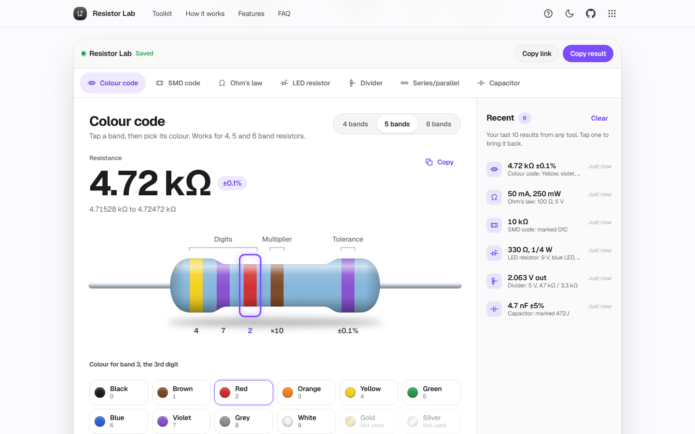

# Resistor Lab

The electronics toolkit that shows its working.

[](https://lz-resistor-lab.pages.dev/)

Mirror: https://lazarzec18.github.io/resistor-lab/



## Features

**Seven tools, one tab each** (deep-linkable: `#colour`, `#smd`, `#ohm`, `#led`, `#divider`, `#series`, `#capacitor`)

- **Colour code**: a realistic SVG resistor for 4, 5 and 6 bands (beige carbon film or blue metal film). Tap a band and pick its colour. You get the value, tolerance range, tempco and the nearest E12, E24 and E96 values with % error. Reverse mode turns `4k7`, `0R47` or `2M2` into bands.
- **SMD code**: decodes 3-digit (`472`), 4-digit (`4702`), R notation (`4R7`, `R47`) and EIA-96 (`01C`) codes, drawn on a chip. It also lists the same value's other markings, and invalid codes get an explanation of the formats.
- **Ohm's law and power**: enter any two of V, I, R and P, each with its own unit (mV/V/kV, µA/mA/A, Ω/kΩ/MΩ, mW/W). The other two are filled in, along with a suggested resistor power rating.
- **LED resistor**: supply, LED colour preset (red 2.0 V to blue/white 3.1 V, or custom), current and number of LEDs in series. Gives the exact R, the next E12 and E24 values up, the actual current and power with each, and a power rating with a 2× margin. Warns when the supply is too low or the headroom is small.
- **Voltage divider**: Vout from Vin, R1 and R2, with an optional load and how far it pulls Vout down. Or give a target Vout and get the best E12 or E24 pair, plus two runners-up and the exact R1 for a fixed R2.
- **Series and parallel**: a list of resistors with unit pickers, the equivalent in both configurations, and a schematic drawn from your list.
- **Capacitor code**: `104` gives 100 nF in pF, nF and µF, and tolerance letters (J, K, M and more) are decoded. It works in reverse too: `4n7` with J gives `472J`.

**Around the tools**

- Every tool shows a diagram and the formula with your numbers in it.
- **Recent** keeps your last 10 results from any tool. Tap one to restore it, or clear the list (with undo).
- Copy-result buttons, plus a copy-link button for the current tool.
- Units are formatted throughout (4.7 kΩ, 220 Ω, 1.2 MΩ, 330 mW). Errors show next to the field and say how to fix them.
- Light and dark mode, a guided tour, keyboard support and layouts built for 390 px phones.

## How it works

All the maths lives in `core.js` as pure functions, separate from the page. Colour bands are built through strings (`47e-1`) so 4.7 Ω is exactly 4.7 and not 4.700000000000001. E-series lookups compare values on a log scale across neighbouring decades. EIA-96 codes index straight into the 96-value E96 table.

The divider pair search tries every E12 or E24 value from 1 kΩ to 100 kΩ as R2. For each one it takes the nearest and next-higher standard R1, then ranks the pairs by error, breaking ties towards R2 = 10 kΩ. The LED tool rounds up, never to the nearest value, so the real current never exceeds what you asked for. Ohm's law keeps track of the last two fields you typed, so filling in a third replaces the oldest one.

`app.js` is a small shell. Each tool registers `html`, `bind`, `sync` and `render`. The shell handles tabs and hash routing, saves state through `ZL.store`, and pushes a result to Recent once you stop typing for about a second (or straight away when you copy).

## Tech

- Vanilla HTML, CSS and JavaScript. No framework and no build step.
- Shared Zec Labs kit (`zl.css`, `zl.js`) for the nav, tour, toasts, dialogs and storage.
- Inline SVG for the resistor, chip, capacitor and schematics, styled with CSS tokens for light and dark mode.
- Geist, Geist Mono and STIX Two Text (for the formulas) from Google Fonts.

## Run locally

```sh
python3 -m http.server
```

Then open http://localhost:8000/.

## Project structure

| File | What it does |
| --- | --- |
| `index.html` | Page: hero, toolkit, how it works, features, FAQ |
| `core.js` | Pure maths: colour codes, E-series, SMD, Ohm's law, LED, divider, capacitor codes |
| `app.js` | Shell: tabs, hash links, state, Recent, copy, formula helpers |
| `tool-*.js` | One file per tool (colour, smd, ohm, led, divider, series, cap) |
| `styles.css` | App styles on top of the kit |
| `zl.css`, `zl.js` | Shared Zec Labs kit (unchanged) |
| `_headers` | Cloudflare Pages security and cache headers |

## Testing

There's a Python Playwright suite (159 checks) that drives the real page with clicks and typing:

- Every v1 colour-code check: 4, 5 and 6 bands, gold and silver multipliers, invalid band colours, tempco, hover labels, reverse mode for seven inputs and five invalid ones.
- SMD: 472 = 4.7 kΩ, 4R7 = 4.7 Ω, 01C = 10 kΩ, plus 4-digit, R47 and 68X, and an explanation for each bad format.
- Ohm's law: V and I give R and P, P and R give V and I, the newest two inputs win, unit changes recompute, and negative values are rejected.
- LED: 5 V, red 2.0 V, 20 mA gives 150 Ω exact, a 150 Ω E12 part at 60 mW and a 1/8 W rating. Strings of LEDs round up, and a supply that's too low is caught.
- Divider: 12 V with 10k/10k gives 6 V, and a 10k load gives 4 V. The E12 and E24 pair suggestions are checked against a brute-force search, and "Use" sends the pair back to Find Vout.
- Series and parallel with unit pickers, the schematic, undo, and adding the colour-code value.
- Capacitor: 104 = 100 nF, 472J = 4.7 nF ±5%, 103K, and reverse encoding.
- Copy to clipboard, Recent ordering, persistence, restore and clear/undo, hash deep links for all seven tools, the tour (all 8 steps), state surviving a reload, no console errors, no horizontal overflow at 390 px, 44 px touch targets and 16 px inputs.

Part of Zec Labs, a set of small, polished web apps by [Lazar Zec](https://github.com/LAZARZEC18). See them all at https://lazarzec.pages.dev/
